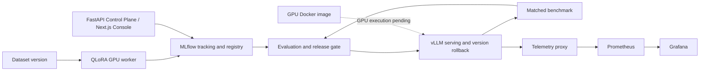

# ModelOps Platform — Architecture

**Enterprise LLM Production Lifecycle Platform**

The authoritative current architecture is [FINAL_ARCHITECTURE.md](docs/FINAL_ARCHITECTURE.md): training, model management, evaluation, serving and observability built on the existing FastAPI, Next.js, MLflow and vLLM implementation.

[Interactive source-pinned diagram](docs/architecture/llm-platform-20261013.html) · [Final evidence report](docs/evidence/final-validation-report.md)

ModelOps is the control/lifecycle layer. Transformers/PEFT, LeRobot and vLLM remain upstream training/inference engines; the project does not claim to have independently invented them. GPU weights and raw records remain in private project storage and are bound to run IDs and hashes.

The existing Kubernetes Operator, CRDs, Helm and Argo modules are retained. This RTX3090 container validates the native Linux route; it cannot serve as a Kubernetes node or execute Docker GPU workloads. See the [preserved upstream architecture](docs/upstream/ARCHITECTURE.md) for the inherited Kubernetes platform design and [the final evidence matrix](docs/evidence/final-validation-report.md) for what was actually run.

## Advanced native execution — 2026-10-14

The existing FastAPI/Next.js/MLflow architecture is retained. Explicit native adapters now manage isolated vLLM/SGLang runtimes, immutable package verification, GPU lease/process ownership, fixed protocol benchmark, local INT4 conversion, controlled QLoRA resume and engineering quality/regression decisions. No new UI, Kubernetes cluster or diagram was introduced. SGLang/INT4 use the explicit adapter; the older NativeDeployment API's validation scope remains distinct. Raw weights, optimizer/RNG, prompts and traces stay private. Current acceptance: docs/evidence/inference-hardening/validation_report.md.
