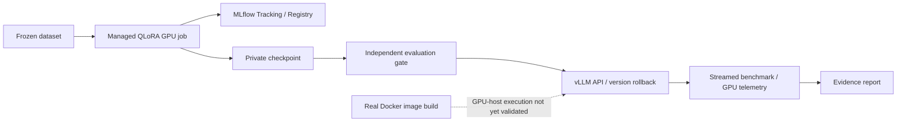

# ModelOps Platform

**Enterprise LLM Production Lifecycle Platform**

ModelOps gives model-owning teams a traceable path from a dataset version to a tested model release: **QLoRA training → MLflow tracking/registry → evaluation and release gate → vLLM serving → benchmark → monitoring → release/rollback**. It extends the existing FastAPI control plane and Next.js console rather than replacing them with a training notebook or chatbot.

> **Validation status:** historical lifecycle evidence is on RTX3090; current advanced native GPU evidence below is separately validated. GPU Docker execution is **SKIPPED** on the current rented container, and enterprise production HA/security deployment is not certified. Every implemented feature is separated from its runtime evidence.

[中文](README.zh-CN.md) · [Final evidence report](docs/evidence/final-validation-report.md) · [Architecture](docs/FINAL_ARCHITECTURE.md) · [Matched model benchmark](benchmark/model-comparison.md)


<!-- INFERENCE_HARDENING_BEGIN -->
## Advanced GPU evidence — 2026-10-14

Single-host engineering validation: **PASS**. The current driver reports RTX4080 SUPER, CC8.9; old RTX3090 results below remain historical and are not mixed.

- **Two engines:** vLLM0.10.2 / SGLang0.4.10, 90 matched points and2,880 actual requests, three repeats at each workload/concurrency. Same pinned model/tokenizer/FP16/sampling/cache protocol.
- **Real quantization:** own GPTQ and AWQ W4A16 conversion, not downloaded ready-made weights. With the same3GiB KV budget, GPTQ C32 decode throughput is 2988.09 vs 1903.93 tokens/s (1.57x); peak visible GPU memory is 6163 vs 10161MiB (39.3% lower).
- **Quality gate:** GPTQ passed the frozen engineering policy on128 QA +24 smoke samples. AWQ failed quality and is rejected. This is not broad task-quality certification.
- **GPU profile:** real PyTorch/CUDA traces and a repeated-context prefix-cache A/B: 2.28–2.30x throughput, 96/96 output texts identical. No custom kernel or measured HBM bandwidth claim.
- **Managed training:** two64-update BF16/NF4 QLoRA configurations plus a controlled interruption/resume. Checkpointing reduced Torch peak allocation by 51.5%, with measured speed trade-offs. Resume weights/loss/sample sequence matched exactly.
- **Reliability:** actual loader, timeout, streaming, owned crash/restart and CUDA OOM faults; hash/version/quality/performance/telemetry guards fail closed. Native Prometheus/Grafana retained.
- **Boundaries:** GPU Docker and Nsight remain SKIPPED; no production business SLO, multi-node scale or domain-learning improvement is claimed.

[Current acceptance](docs/evidence/inference-hardening/validation_report.md) · [Engine results](benchmark/engine-comparison.md) · [Quantization](benchmark/quantization-comparison.md) · [GPU profile](docs/GPU_PERFORMANCE_PROFILING.md) · [Training/resume](experiments/training/optimization-report.md) · [Reproduction](deploy/llm-validation/native-hardening/README.md)

<!-- INFERENCE_HARDENING_END -->

## Production validation platform — 2026-10-13


| Capability | Implemented | Validated evidence |
|---|---|---|
| QLoRA / MLflow | Transformers + PEFT worker and version registry | Real 32-update run, checkpoint and adapter; prior evidence retained |
| Evaluation / release gate | Version-bound artifact, quality, serving and performance checks | Actual MLflow v1 decision PASS; unchanged thresholds; quality decline retained |
| vLLM / rollback | Explicit launch/checkpoint verification and version switching | Actual native GPU API and base → trained → base rollback |
| Benchmark | Matched Base/fine-tuned workload with resumable trials | **1,536 real requests**; 12 trials; raw/config/model/source hashes |
| Monitoring | Streaming TTFT/usage/error metrics, GPU gauges, Prometheus/Grafana | Real GPU requests and native scrape/dashboard verification; actual Compose CPU contract in CI |
| Docker / CI | Digest-pinned non-root image, GPU probe, Actions evidence artifacts | Docker build/startup receipts tracked in CI; **GPU container runtime SKIPPED** |
| Console / software | Real API/browser lifecycle and fail-closed tests | 467 pytest passed, 62 unittest passed, 3 browser tests passed; 2 optional tests skipped |

The fine-tuned checkpoint delivered **283.17 output tokens/s at C4** (TTFT P95 133.08 ms; E2E P95 945.47 ms) and **804.54 tokens/s at C16**. Base results were 292.02 and 816.76 tokens/s, respectively. Peak sampled GPU memory was 22,743 MiB. Three trial percentiles are averaged; these are synthetic workloads on one device, not production SLOs. **No model-quality or throughput improvement is claimed.**

[Release decision](docs/evidence/llm-platform-finalization/release_decision.json) · [Live monitoring](docs/evidence/llm-platform-finalization/monitoring-validation.json) · [CI receipts](docs/evidence/llm-platform-finalization/ci-validation.json) · [GPU runtime boundary](docs/evidence/gpu-runtime-validation/validation-report.md)

See [reproduction commands and limitations](docs/evidence/final-validation-report.md#4-reproduction-guide). The earlier optimization run below used a different cache/profile protocol and is not pooled with the matched model comparison.

## LLM Production Validation Sprint

**Real Qwen2.5-3B QLoRA → MLflow → quality gate → vLLM API → benchmark → rollback.** This bounded RTX 3090 run extends the existing ModelOps lifecycle; it does not replace the platform with a standalone training demo.



| Delivery | Actual evidence |
|---|---|
| Training | 32 optimizer updates, 14,966,784 trainable parameters; training-only 14.084 s, worker 53.605 s; 7.655 GiB Torch peak allocation |
| Tracking / Registry | MLflow Run b127f8d1474b414db0025df3a611d5c7; ModelOps Run 7859def0-8be7-4931-a099-1193b790e709; ModelOps-Qwen2.5-3B version 1 READY |
| Evaluation | 24 source-disjoint heldout examples; F1 0.763198 → 0.749309; **quality declined**, unchanged gate passed |
| Serving | Real base → trained → rollback API responses; trained curl response answered Paris |
| Benchmark | 45 valid trials / 5,760 requests, three FP16 profiles, three repeats, concurrency 1/4/8/16/32 |
| Docker | Real digest-pinned image build and CPU startup smoke in Actions; **GPU Docker execution unvalidated** |

| Profile | Concurrency | Requests/s | Output tokens/s | TTFT P50/P95/P99 ms | E2E P95 ms | Peak GPU MiB |
|---|---:|---:|---:|---|---:|---:|
| baseline | 1 | 1.394 | 89.21 | 46.48/48.13/48.86 | 771.07 | 22841 |
| baseline | 4 | 4.880 | 312.34 | 61.01/66.42/67.86 | 855.51 | 22743 |
| baseline | 8 | 9.375 | 600.02 | 28.21/45.38/55.22 | 905.05 | 22743 |
| baseline | 16 | 17.670 | 1130.88 | 43.86/81.44/85.15 | 959.97 | 22743 |
| baseline | 32 | 31.105 | 1990.70 | 96.89/140.26/146.11 | 1053.81 | 22743 |
| batching-token-budget | 32 | 32.534 | 2082.17 | 74.56/141.77/147.89 | 1026.04 | 22669 |
| kv-memory-budget | 32 | 31.654 | 2025.88 | 84.48/138.69/144.40 | 1061.67 | 23895 |

Percentiles are means of three trial percentiles; traffic is synthetic. Default vLLM continuous batching was already active. Full trials include unfavorable tuning results; no production SLO, AWQ speedup, quality improvement or monetary savings is claimed. Kubernetes GPU deployment is out of the revised sprint scope.


Start with [training script/config/example](experiments/training/README.md), [full evidence report](docs/modelops-validation-report.md), [benchmark report](benchmark/report.md), [raw-result hash audit](docs/evidence/llm-validation/benchmark/validation.json), [Docker recipe](deploy/llm-validation/docker-compose.yml) and [actual image build receipt](docs/evidence/llm-validation/docker-image-result.json). Source revision and file hashes are linked in the report. Qwen research-license weights stay private; the repository code license does not grant commercial rights to the model.

```bash
# Run from the project with frozen private inputs and its isolated environments.
.venv/bin/python experiments/training/train.py
.venv/bin/python benchmarks/llm-serving/run.py
# Example against a running validated service; use the actual /v1/models ID:
curl --fail http://127.0.0.1:18000/v1/chat/completions   -H 'Content-Type: application/json'   -d '{"model":"modelops-qwen3b-qlora","messages":[{"role":"user","content":"What is the capital of France?"}],"max_tokens":16,"temperature":0}'
```

On a GPU Docker host, build the image and use the [Compose recipe](deploy/llm-validation/docker-compose.yml) with a read-only private MODEL_DIR and measured MODEL_SHA256. A CPU image build is not a GPU container performance test. The previous v1.0 RC evidence below is a separate earlier experiment, not the denominator for this sprint.

## v1.0 RC: implemented, validated, not yet validated

Model-owning teams need to know which dataset produced a checkpoint, whether that version passed the right evaluation, and how to load or roll it back. This repository proves that lifecycle with bounded real GPU jobs and keeps infrastructure acceptance separate from model-quality claims.

| Capability | Implemented | Validated in this sprint | Not yet validated |
|---|---|---|---|
| Model Registry | LLM/VLM/VLA/Embedding ModelArtifact, immutable model identities, lineage, migrations, ownership and observed deployment state | Reversible SQLite migrations; four legacy VLA versions imported by verified references | VLM native serving; production PostgreSQL runtime |
| Training | Argo/LLaMA-Factory contracts; native Transformers LoRA/QLoRA; retained SmolVLA/LeRobot Flow Matching adapter; six observed job states | Four real RTX 3090 jobs, 160 optimizer updates; Adapter/Checkpoint hashes; pause at step 2 and recovery to step 64 | New SmolVLA jobs through unified REST; Argo GPU scheduling and native full SFT |
| Lifecycle | Evaluation attestation, separate release principal, registered checkpoint, deployment revisions and rollback | Trained Qwen loaded into vLLM, invoked, promoted and rolled back; 384D CPU embedding; 50×7 frozen VLA prediction | GPU Kubernetes rollout, real enterprise OIDC sign-off, TEI/SGLang runtime |
| Inference | Official vLLM benchmark, GPU samples, explicit model/engine/quantization/cache/custom-policy CRD | 40/40 synthetic C4 requests; 6.43 req/s; 183.7 output tokens/s; TTFT P95 34.8 ms | Production workload SLO, hardware-matched acceleration gain and maximum capacity |
| Operations | Protected tenant metrics, audit, recovery/reconciliation, fail-closed production gates | 180 Python tests plus two optional runtime skips; Operator unit/envtest and GitHub CPU kind; PostgreSQL schema CI; Helm; Console types/build; real metadata backup/restore | Full object-store/cluster disaster recovery, real OIDC and multizone HA |

**Quality results remain visible:** broad LoRA/QLoRA Token-F1 0.254/0.267 failed the unchanged 0.55 threshold. One additional frozen short-answer task scored 0.561 for both base and trained model, passing the gate with **no observed quality improvement**. This validates a lifecycle, rather than general business-task quality.

See the [execution report](docs/v1/SPRINT_REPORT.md), [validation receipts](docs/v1/results/validation.json), [real training identities](docs/v1/results/training.json), [benchmark](docs/v1/results/benchmark-report.md), [status](docs/v1/status.json) and [reproduction guide](docs/v1/REPRODUCE.md). Weights, datasets and private robot observations remain in the owned cloud project and are excluded from Git.

**Architectural separation:** production metadata lives in PostgreSQL, Kubernetes/Argo own cluster workloads, and private object storage owns checkpoint bundles. The explicit Linux development backend owns observed processes and receipts and is rejected in production mode. Text Token-F1 cannot qualify a robot policy; robotics retains its own release gate.

## Runtime architecture

Source-linked [architecture JSON](docs/architecture/v1-final.json) and [self-contained interactive HTML](docs/architecture/v1-final.html) cover the Control API, observed runtimes, metadata, model adapters, serving and private artifacts. Native GPU proof and cluster validation are marked separately.

## Repository layout

- `control-plane/` — Python/FastAPI management API, SQL models, migrations, tenant roles and reconciliation.
- `console/` — Next.js management UI with browser tests against the real API.
- `operator/` — Go Kubernetes controllers and deployment contracts.
- `charts/` — Helm stack, gateway, engines, training and observability.
- `pipelines/` — adapter/checkpoint processing, independent evaluation and evidence gates.
- `benchmarks/inference/` — real endpoint measurement harness and strict A/B reporting.
- `ops/` — preflight, recovery, safety scripts and real CPU Kubernetes checks.
- `docs/` — architecture, operation guides, provenance, audit and acceptance roadmaps.

## Run the local Control API + Console (no GPU)

Install Docker and Compose, then:

```bash
cp .env.compose.example .env
# Set strong unique MODELOPS_PG_PASSWORD and MODELOPS_JWT_SECRET in .env.
docker compose up --build -d postgres
docker compose run --rm --no-deps api alembic upgrade head
docker compose up --build -d api console
```

The local Console is at `http://localhost:3000`; API at `http://127.0.0.1:8080`. In development, an explicitly enabled dev token may be issued with `python -m modelops.devtoken`. **The default local metadata mode rejects execution without a real backend; the explicit Linux development worker is documented in the v1 reproduction guide**; a working UI does not imply a running model. See [setup guide](docs/LOCAL_AND_PRODUCTION_SETUP.md).

### Test without GPU

```bash
cd control-plane
python -m pip install -e ".[dev]"
python -m pytest -q
cd ..
python -m unittest discover -s benchmarks/inference -p 'test_*.py' -v
```

GitHub Actions additionally exercise Operator/Helm contracts, browser API E2E, container builds and CPU-kind checks. The **Control API → actual Kubernetes CRD → Operator → scale/delete** integration test is in `control-plane/tests/test_kind_runtime_e2e.py` and runs only when a real tenant-scoped kind Operator is bootstrapped by CI. This is a **CPU software acceptance gate**, not a model-serving test.

## Validation and evidence

| Evidence tier | What it proves | What it does not prove |
|---|---|---|
| T0 — source/provenance | Auditable upstream attribution and committed implementation | Code correctness |
| T1 — static/automated | Tests, Helm manifests and basic API/browser contract behavior | End-to-end production operation |
| T2 — real CPU Kubernetes | Actual namespaced resources, controllers and service checks | GPU decoding/training or high availability |
| T3 — GPU serving | Live TTFT, TPOT, p95/p99 latency, throughput, VRAM, controlled comparison | Improved business task quality |
| T4 — GPU training | Real LoRA/QLoRA weights, independent heldout and serving promotion | Production scale/HA |
| T5 — production-like cluster | Multi-node failover, tenant isolation, operational SLO and restore drills | Permanent availability guarantees |

No unsupported production uptime, speedup, cost, model quality or GPU utilization statistics are claimed. For an up-to-date run-specific judgment, inspect [Actions](https://github.com/Benjamindaoson/ModelOps-Platform/actions) and the commit SHA. Earlier [October 11 audit](docs/PLATFORM_AUDIT_2026-10-11.md) is a dated snapshot and **understates later control-plane and console work**. Live hardware and deployment readiness remain separate acceptance requirements.

## Next acceptance gates

1. Real CI kind API/Operator/Gateway lifecycle, concurrency/reconciliation, role isolation and failure propagation.
2. Parameterized Argo Run → actual checkpoint → heldout → signed quality gate → model release with rollback.
3. **RTX 3090** controlled vLLM/SGLang comparisons with identical weights/workload and attached raw telemetry.
4. Production OIDC, DB/S3 restore drill, immutable image digests and multi-node chaos testing.

See [integration gates](docs/INTEGRATION_ROADMAP_2026-10-12.md), [training lifecycle](docs/TRAINING_JOB_LIFECYCLE.md), [verified backup design](docs/BACKUP_RECOVERY_V2.md), and [benchmark guide](benchmarks/inference/README.md).

## Open-source foundation and licensing

This project is derived from [GaeaRuiW/kube-llmops](https://github.com/GaeaRuiW/kube-llmops), pinned to commit `74f8db47fa2690a4e71ae31532f36b35a587d266`, under Apache-2.0. The inherited Operator/Helm/observability architecture is **credited, not misrepresented as original work**. The added Control API, Console and reconciliation/evidence work are separately visible in Git history. See [upstream provenance](docs/UPSTREAM_PROVENANCE.md), [original upstream README](docs/upstream/README.md), and [LICENSE](LICENSE). Audit dependency-specific licenses before commercial deployments.
