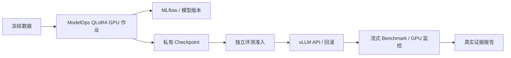
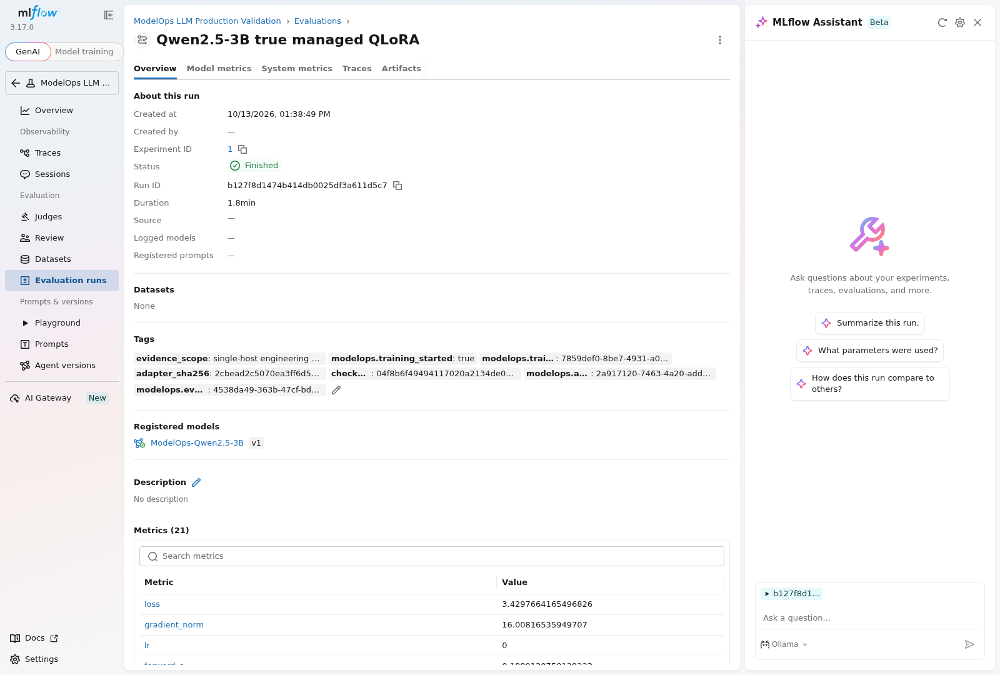
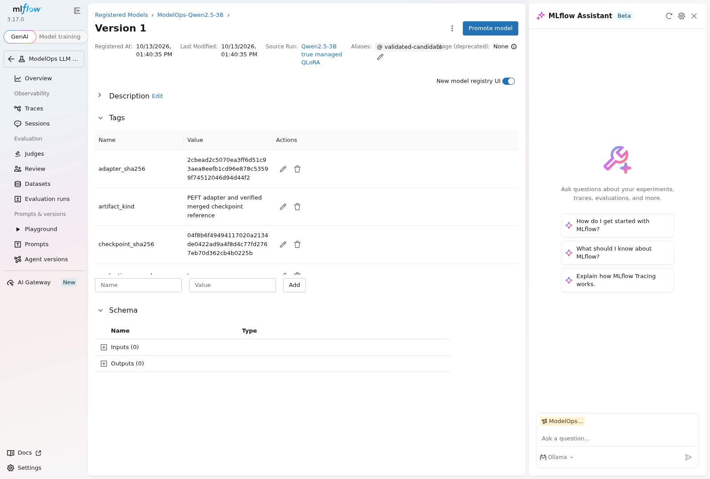
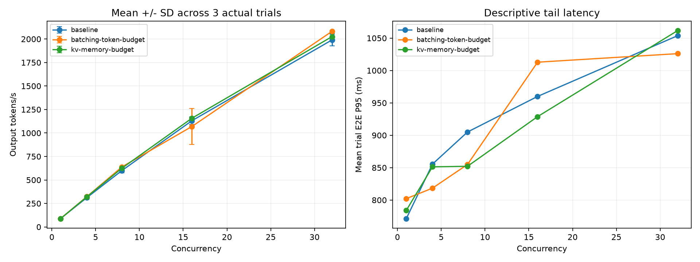

# ModelOps Platform

**企业级 LLM 全生命周期验证平台｜Enterprise LLM Production Lifecycle Platform**

面向企业内部模型团队，将数据版本、QLoRA 训练、MLflow 追踪与注册、评估和发布准入、vLLM 服务、性能测试、监控及版本回滚串成可追溯流程。沿用现有 FastAPI 控制面与 Next.js 管理台，模型与原始记录留在私有云端，以 Run ID 和哈希关联。

> **实测边界：** 已验证 RTX3090 单机原生 LLM 生命周期；当前云容器没有 Docker GPU runtime，该项明确为 **SKIPPED**。尚未宣称企业生产高可用、安全部署或模型质量提升。实现、CPU 合同测试与真实 GPU 结果分别列明。

[English](README.md) · [最终验收报告](docs/evidence/final-validation-report.md) · [分层架构](docs/FINAL_ARCHITECTURE.md) · [模型对照](benchmark/model-comparison.md)

## 本轮完善与真实结果｜2026-10-13


- **发布 Gate：** 解析实际 MLflow model version，核对 Checkpoint/Adapter SHA、训练来源、独立评估、在线模型身份及三次同配置性能记录；实际检查 PASS，保留事先冻结的阈值。
- **模型对照：** 12 个试验点、1,536 次真实 GPU 请求；Base / Fine-tuned，C4/C16，各三次重复、每次 128 请求，同样关闭 prefix cache。
- **推理结果：** 微调模型 C4 为 283.17 output tokens/s，TTFT P95 133.08 ms，E2E P95 945.47 ms；C16 为 804.54 tokens/s。Base 分别为 292.02 和 816.76 tokens/s。峰值整卡显存 22,743 MiB。微调模型吞吐略低，**不声称加速或质量提升**。
- **真实监控：** 新增流式 TTFT、最终 token usage、请求/错误与 GPU 指标；真实模型请求、Prometheus 查询及 Grafana 面板均已验证。Docker Compose 的 CPU 测试使用明确标注的合成输入，不冒充 GPU 模型推理。
- **工程质量：** 467 项 pytest、62 项 unittest、3 项浏览器测试通过；2 项可选测试跳过。完成 Next.js typecheck/生产构建及真实隔离 API 的浏览器流程。
- **Docker 与 CI：** 新增固定基础镜像 digest、非 root 启动、GPU/CUDA/API 探针、自动构建与证据上传。实际 GPU 容器运行仍需已授权 NVIDIA Container Toolkit 主机，当前不具备。

[实际发布决策](docs/evidence/llm-platform-finalization/release_decision.json) · [监控收据](docs/evidence/llm-platform-finalization/monitoring-validation.json) · [CI 收据](docs/evidence/llm-platform-finalization/ci-validation.json) · [GPU runtime 报告](docs/evidence/gpu-runtime-validation/validation-report.md)

延迟是三次试验分位数的均值，不是全部请求合并后的分位数。下方保留的早期 45 点优化实验采用不同缓存和 profile 协议，不与本轮模型对照混算。复现方法、许可及未完成项见最终报告。

## LLM Production Validation Sprint

本轮证明的是可追溯的模型生命周期：真实 GPU 微调、独立评测、版本登记、推理 API、性能测量与回滚。沿用原有 ModelOps 控制面和执行器，模型与数据留在私有云端目录。

- **真实训练：** Qwen2.5-3B-Instruct，NF4 QLoRA、BF16 计算；32 次更新、batch 2、rank 8、alpha 16，14,966,784 个可训练参数。训练段 14.084 秒；含加载/导出的 worker 总耗时 53.605 秒；Torch 峰值分配 7.655 GiB。替换抽样不等于完整遍历一个 epoch。
- **模型追踪：** ModelOps Run 7859def0-8be7-4931-a099-1193b790e709，MLflow Run b127f8d1474b414db0025df3a611d5c7；实际注册 ModelOps-Qwen2.5-3B version 1 READY，关联 Adapter、Checkpoint、参数和评测。
- **质量证据：** 64 个训练样本，24 个来源隔离的开发验证样本；F1 0.763198 → 0.749309。结果略降，未修改原有准入门槛，不能写成质量提升。
- **服务闭环：** 实际完成 base → 微调模型 → rollback 三次 vLLM 加载和 OpenAI-compatible API 调用。
- **性能：** 45 个有效测量点、5,760 次真实流式请求；3 种 FP16 配置、每组 3 次重复、并发 1/4/8/16/32。
- **容器：** GitHub Actions 实际构建镜像并执行 CPU 启动合同检查；GPU 容器推理尚未验证。本轮按用户调整不做 Kubernetes。

| Profile | Concurrency | Requests/s | Output tokens/s | TTFT P50/P95/P99 ms | E2E P95 ms | Peak GPU MiB |
|---|---:|---:|---:|---|---:|---:|
| baseline | 1 | 1.394 | 89.21 | 46.48/48.13/48.86 | 771.07 | 22841 |
| baseline | 4 | 4.880 | 312.34 | 61.01/66.42/67.86 | 855.51 | 22743 |
| baseline | 8 | 9.375 | 600.02 | 28.21/45.38/55.22 | 905.05 | 22743 |
| baseline | 16 | 17.670 | 1130.88 | 43.86/81.44/85.15 | 959.97 | 22743 |
| baseline | 32 | 31.105 | 1990.70 | 96.89/140.26/146.11 | 1053.81 | 22743 |
| batching-token-budget | 32 | 32.534 | 2082.17 | 74.56/141.77/147.89 | 1026.04 | 22669 |
| kv-memory-budget | 32 | 31.654 | 2025.88 | 84.48/138.69/144.40 | 1061.67 | 23895 |

表中延迟是三次试验分位数的均值，不是合并请求后的分位数。默认 vLLM 已启用连续批处理；调整的是 token 预算和显存预留。完整报告保留性能变差的配置与被排除的干扰测量，不声称生产 SLO、通用加速倍数或费用节省。







查看 [完整实验报告](docs/modelops-validation-report.md)、[训练入口](experiments/training/README.md)、[全部性能数据](benchmark/report.md)、[证据与 Hash](docs/evidence/llm-validation/benchmark/validation.json)、[真实镜像构建记录](docs/evidence/llm-validation/docker-image-result.json) 和 [GPU 主机 Compose 启动方式](deploy/llm-validation/docker-compose.yml)。权重未上传到 GitHub；Qwen 模型研究许可证与平台 Apache-2.0 源码许可分别适用，不能据此声称可无限制商用。

## 五大功能模块

| 模块 | 已建设的主要软件能力 | 还需要的独立验收 |
|---|---|---|
| **管模型** | 租户模型注册、不可变版本、数据集、RBAC、审批及审计、统一 Control API | 真实 OIDC、强租户隔离、可信模型产物验真 |
| **训模型** | 动态训练任务、Argo/LLaMA-Factory、LoRA/QLoRA 配置、留出集评估及质量门禁 | 真 GPU 训练权重、独立测试、完整上线闭环 |
| **部署模型** | ModelDeployment Operator/CRD、vLLM、SGLang、TEI、llama.cpp、版本/灰度/回滚接口 | GPU 模型实际启动、真实加权流量、故障回滚 |
| **加速模型** | Benchmark、GPU 指标采集与 A/B 对照、量化/KV Cache/Batch 配置 | 同硬件同模型的 TTFT/TPOT、吞吐、显存、质量实测 |
| **运营模型** | Prometheus/Grafana、租户级 Operator 权限、API/控制台镜像、审计、恢复 Worker、备份校验 | SLO 告警、真实备份恢复、RPO/RTO、多节点 HA |

整体架构中，**PostgreSQL 保存管理元数据与用户期望状态**，**Kubernetes CRD 和 Argo 提供运行态事实**，**S3/MLflow 保存模型产物与版本**。UI 只调用 Control API，不应持有 Kubernetes 管理凭据。

## 代码结构

- `control-plane/`：FastAPI、SQL、迁移、租户权限、操作审计、任务恢复。
- `console/`：Next.js 产品管理控制台与 Playwright E2E。
- `operator/`：Go Kubernetes Operator、CRD、控制器。
- `charts/`：Helm、网关、推理引擎、训练及观测组件。
- `pipelines/`：训练后模型产物、留出集评估与质量门禁。
- `benchmarks/inference/`：对真实推理接口的 Benchmark 和 A/B 一致性检查。
- `ops/`：安全预检、CPU Kubernetes 测试、备份与恢复。
- `docs/`：平台架构、实施与验收、技术限制、来源说明。

## 本地启动（无需 GPU）

安装 Docker Compose，在项目根目录执行：

```bash
cp .env.compose.example .env
# 在 .env 中配置随机、唯一的 MODELOPS_PG_PASSWORD、MODELOPS_JWT_SECRET。
docker compose up --build -d postgres
docker compose run --rm --no-deps api alembic upgrade head
docker compose up --build -d api console
```

Console 默认 `http://localhost:3000`，API 默认 `http://127.0.0.1:8080`。本地开发模式没有接入 Kubernetes 时，**模型部署与训练接口会拒绝创建**，不会以 Mock 状态冒充部署成功。详见 [安装与环境说明](docs/LOCAL_AND_PRODUCTION_SETUP.md)。

### 无 GPU 自动化测试

```bash
cd control-plane
python -m pip install -e ".[dev]"
python -m pytest -q
cd ..
python -m unittest discover -s benchmarks/inference -p 'test_*.py' -v
```

GitHub Actions 还会运行 Go/Helm 契约测试、Web 控制台端到端测试、容器镜像构建和 CPU kind。最新新增的 `test_kind_runtime_e2e.py` 专门验证真实 **FastAPI → Kubernetes CRD → Operator → 扩缩/删除**，需要在 CI 准备实际 Kubernetes 环境。这不是 GPU 推理测试。

## 验收层级

| 级别 | 证据标准 |
|---|---|
| T0 源码 | 代码与上游出处可追溯 |
| T1 自动化 | 单测、静态校验、UI/API/Helm 契约 |
| T2 CPU Kubernetes | 真实命名空间、Operator 和服务组件运行 |
| T3 GPU Serving | 真机测量 TTFT、TPOT、吞吐、显存、延迟尾部 |
| T4 GPU Training | 真正产生权重、独立评测、模型发布与回滚 |
| T5 生产类集群 | 多节点容错、最小权限、恢复演练及 SLO |

**只有证据达到对应层级，才对外陈述相应成果。** 2026 年 10 月 11 日的 [旧平台审计](docs/PLATFORM_AUDIT_2026-10-11.md) 是当时快照，不包含后续所有控制面与前端提交，不能作为最新完成度。应以相应提交 SHA 的 [CI 记录](https://github.com/Benjamindaoson/ModelOps-Platform/actions) 和原始运行日志为准。

## 剩余重点

优先把无 GPU 的真实跨组件全链路和安全/恢复验收做完，然后用 RTX 3090 测试同权重 vLLM/SGLang、量化、KV Cache、批处理策略，保存原始请求/显存/延迟数据；再跑真实 LoRA/QLoRA 微调、独立留出集评估、质量审核、Canary 与回滚。多 GPU 和多节点 HA 是后续独立测试，不把它们混入单卡成绩。

相关文档：[跨组件验收计划](docs/INTEGRATION_ROADMAP_2026-10-12.md) · [训练任务生命周期](docs/TRAINING_JOB_LIFECYCLE.md) · [备份恢复](docs/BACKUP_RECOVERY_V2.md) · [推理测试](benchmarks/inference/README.md)。

## 开源来源与授权

本仓库基于 [GaeaRuiW/kube-llmops](https://github.com/GaeaRuiW/kube-llmops) 的 Apache-2.0 开源版本（固定来源提交 `74f8db47fa2690a4e71ae31532f36b35a587d266`）进行二次开发。上游 Operator、Helm 和观测体系是继承基础；新增 Control API、Console、恢复与证据校验等由 Git 历史区分。保留 [上游来源记录](docs/UPSTREAM_PROVENANCE.md)、[原上游 README](docs/upstream/README.md) 和 [LICENSE](LICENSE)。商用需单独审查各依赖许可证及安全配置。
