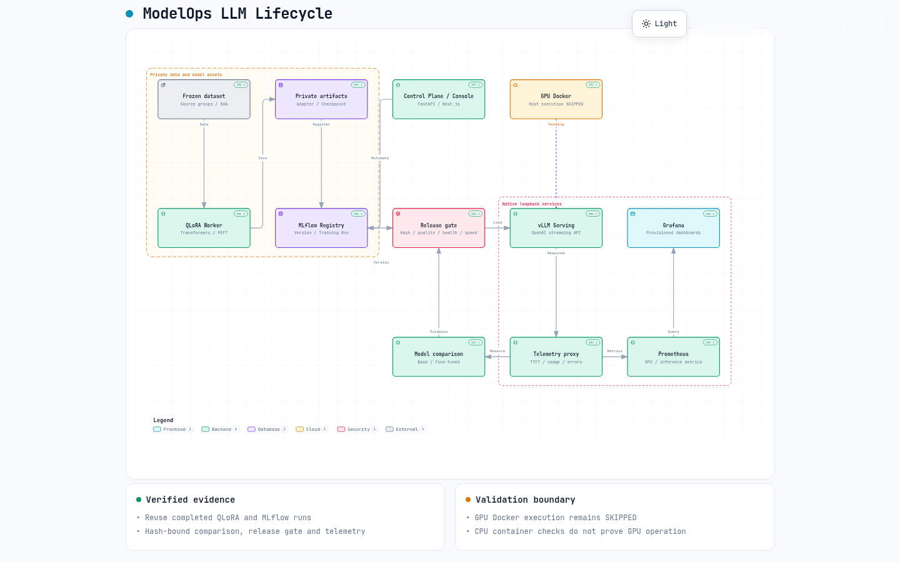

# Final LLM lifecycle architecture

ModelOps coordinates model-owning teams' datasets, training runs, model versions, release checks, inference and operations. This sprint extends the existing implementation; it adds no Kubernetes deployment and no new application architecture.

[Interactive, self-contained diagram](architecture/llm-platform-20261013.html) · [JSON source](architecture/llm-platform-20261013.json) · [Validation receipt](evidence/llm-platform-finalization/architecture-receipt.json)

Diagram sources are pinned to public commit `d37241eb32183afda7affa7ff4df525dee6ac2fb`. It has 12 components, two private/loopback boundaries and an explicitly pending GPU Docker path. Nine static checks and browser containment/readability checks passed; the rendered English image was visually inspected. Earlier diagrams remain intact.

## Training layer

Frozen dataset manifests identify train/heldout sources. The existing single-GPU worker uses Transformers, PEFT and bitsandbytes for NF4 QLoRA; it persists checkpoint, adapter, optimizer/scheduler/RNG and step metrics through the existing Linux TrainingJob lifecycle. SmolVLA uses its own robotics adapter and continuous-action policy service; it is not routed through vLLM.

Source: `pipelines/training/sft_worker.py`, `pipelines/training/data_contract.py`, `experiments/training/`.

## Model management layer

FastAPI and the Next.js console retain tenant-scoped registries and audit contracts. ModelOps and MLflow records link source model, frozen data, training Run ID, checkpoint/adapter SHA, evaluation and deployment version. Private weights are referenced by immutable identity rather than copied into Git or the Docker image.

Source: `control-plane/modelops/`, `ops/mlflow_validation.py`, `console/`.

## Evaluation layer

The independent quality gate revalidates checkpoint contents, source-disjoint heldout examples and actual scores. The final release gate resolves an MLflow version, verifies its training lineage and hashes, checks the currently loaded serving identity and repeated model-matched benchmark thresholds. Missing, changed or wrong-version evidence fails closed.

Release decisions record their check-time evidence; a PASS is not a perpetual claim that a service is still running. The present 24-example quality check is a bounded engineering gate, not business-quality certification.

Source: `pipelines/evaluation/run.py`, `ops/model_release_gate/`.

## Serving layer

The shared launch contract verifies the checkpoint before starting vLLM. Native API and rollback were measured on RTX 3090; the Docker image is digest-pinned, non-root, uses read-only model mounts, and includes a GPU/CUDA/API probe. **The rented cloud container cannot execute Docker GPU workloads.** CPU image build/startup checks and native CUDA inference are separate evidence.

The telemetry proxy forwards completions without changing generated choices; this was checked against the actual GPU model. It restricts upstream origins to loopback HTTP and stays on loopback. External serving requires a protected gateway, authentication and TLS.

Source: `ops/vllm_start.py`, `ops/platform_serving.py`, `deploy/llm-validation/gpu-runtime/`, `ops/observability/`.

## Observability layer

The CPU proxy exports request/error counters, actual first-content TTFT, end-to-end latency, final token usage and token rate. Missing token usage is explicitly counted. NVIDIA metrics cover the entire device, not one request. Prometheus scrapes the exporter; Grafana provisions the supplied dashboard. Native services were verified against real GPU inference. Compose uses isolated persistent volumes and a required password; CPU CI exercises that stack using an explicitly synthetic input fixture.

Source: `deploy/monitoring/`, `ops/native_monitoring.py`, `ops/validate_live_monitoring.py`, `ops/validate_monitoring_compose.py`.

## Release and rollback

Existing ModelOps deployment/version contracts retain rollback capability. Native base → fine-tuned → base rollback API responses belong to the earlier frozen lifecycle evidence; this sprint adds a version-bound release decision and a matched model comparison. It does not re-run training or falsely represent local process management as Kubernetes scheduling.

## Operational boundaries

Single-node validation does not establish production HA, failover under load, external OIDC integration, tenant isolation under hostile workloads, multi-node GPU scheduling or application ROI. The original Kubernetes/Argo/operator modules remain available and are documented separately; none replaces the actual native measurements in this sprint.
