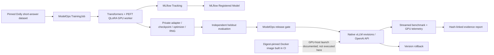

# ModelOps LLM Production Validation Report

## Acceptance and scope

The revised sprint completed one actual managed Qwen2.5-3B QLoRA job, MLflow registration, independent heldout evaluation, native vLLM API loading and rollback, 45 valid serving measurements and an actual Docker image build. This proves a bounded model lifecycle; it does not certify enterprise production reliability or demonstrate better task quality.

Kubernetes GPU Pods were explicitly removed by the user. The rented GPU container has no authorized host Docker/Kubernetes runtime. Docker build and CPU image startup were executed in GitHub Actions; **GPU inference inside Docker remains unvalidated**. Native GPU vLLM inference is independently verified. AWQ and larger training are outside the revised scope.

## System architecture



The existing Control API, registry, state reconciler, GPU worker, release gate and benchmark runner remain authoritative. Added scripts orchestrate those components; they do not replace SmolVLA with text training or build another platform.

## Hardware and exact software

- GPU: NVIDIA GeForce RTX 3090, 24576 MiB; NVIDIA driver 580.173.02.
- CPU: 12 logical and 12 affinity CPUs.
- Visible RAM: 50,575,044,608 bytes (47.10 GiB). No smaller memory/CPU cgroup quota was reported; this is environment visibility, not a guaranteed cloud SLA.
- GPU environment: torch 2.8.0, transformers 4.55.4, peft 0.17.1, bitsandbytes 0.47.0, vllm 0.10.2, psutil 7.2.2, PyYAML 6.0.3.
- Metadata/control environment: Python 3.12.15, MLflow 3.17.0.
- Exact receipts: [hardware](evidence/llm-validation/hardware.json), [versions](evidence/llm-validation/versions.json). The environments are project-local and separate.

## Training results

| Field | Actual value |
|---|---|
| Base model | Qwen/Qwen2.5-3B-Instruct |
| Frozen revision | aa8e72537993ba99e69dfaafa59ed015b17504d1 |
| ModelOps Run ID | 7859def0-8be7-4931-a099-1193b790e709 |
| MLflow Run ID | b127f8d1474b414db0025df3a611d5c7 |
| Dataset | dolly-shortqa-v1: 64 training / 24 source-disjoint heldout examples |
| Recipe | NF4 double quantization, BF16 compute, rank 8, alpha 16, LR 1e-5, sequence limit 384, seed 9101 |
| Budget | 32 optimizer updates, batch 2, sampling with replacement |
| Trainable parameters | 14,966,784 |
| Model load | 9.040 s |
| Training-only wall time | 14.084 s |
| Worker wall time including load/export | 53.605 s |
| Training peak Torch allocated memory | 7.655 GiB |
| Parameter L-infinity update | 0.0001587075 |
| Adapter SHA-256 | 2cbead2c5070ea3ff6d51c93aea8eefb1cd96e878c53599f74512046d94d44f2 |
| Merged checkpoint SHA-256 | 04f8b6f49494117020a2134de0422ad9a4f8d4c77fd2767eb70d362cb4b0225b |

This is real gradient-based QLoRA, evidenced by 32 step logs, changed trainable weights, actual adapter/merged weights and saved optimizer/scheduler/RNG state. Sampling 64 draws with replacement is **not** one deterministic complete epoch. Loading/exporting and upstream asset downloads are not folded into the 14-second training-only figure.

Weights remain in private cloud storage. All 11 source model files were independently checked against official Hugging Face Git/LFS identities after transport from the official Qwen ModelScope mirror. Transport problems and interrupted attempts remain in private logs. No new model weights or full source dataset are pushed to GitHub.

Receipts: [training metrics](../experiments/training/metrics.json), [step logs](evidence/llm-validation/training/training_log.json), [frozen config](../experiments/training/config.yaml), [official source identity](evidence/llm-validation/training/official-source.json).

## Evaluation and registry

| Metric, 24 heldout examples | Frozen base | Trained candidate |
|---|---:|---:|
| Token F1 | 0.763198 | 0.749309 |
| Exact match | 14/24 | 13/24 |

Candidate-minus-base F1 = **-0.013889**. The unchanged engineering gate F1 >= 0.55 and delta >= -0.02 passed. **Quality declined; no improvement is claimed.** Twenty-four narrow short-answer examples do not establish general model quality, statistical superiority or production suitability.

Actual MLflow Registered Model **ModelOps-Qwen2.5-3B version 1** is READY and refers to Run b127f8d1474b414db0025df3a611d5c7. Hyperparameters, per-step metrics, evaluation metrics, real adapter files and a verified private merged-checkpoint reference are recorded. MLflow pyfunc serving is not claimed.

ModelOps initially registered the single checkpoint file, then registered version 2 for the full serving package used by evaluation. These are distinct packaging identities of the same measured weights, not modified checkpoints. The evaluated/deployed package has its own tree digest and lineage. Historical metadata fields are preserved; independent receipts, not an unverified DB flag alone, establish hashes.


Screenshots were captured from the running local MLflow server, with DOM text checks and zero page errors. Receipts: [registry](evidence/llm-validation/registry/model_artifact.json), [evaluation and predictions](evidence/llm-validation/evaluation.json), [screenshot validation](evidence/llm-validation/screenshots/validation.json).

## Serving and rollback

The actual native vLLM controller loaded base generation 1, trained generation 2 and base rollback generation 3. All three returned real OpenAI-compatible responses with the correct artifact IDs. Cold readiness was approximately 32.30 / 30.29 / 32.31 seconds; this is separate from warm request latency.

An actual curl request to the trained model answered “Paris”. The API smoke call, release approval, evaluation correlation and rollback response are retained in [lifecycle evidence](evidence/llm-validation/serving/lifecycle.json), [curl response](evidence/llm-validation/serving/curl_response.json) and [API response](evidence/llm-validation/serving/api_response.json).

```bash
curl --fail --max-time 60 http://127.0.0.1:18000/v1/chat/completions   -H 'Content-Type: application/json'   -d '{"model":"modelops-qwen3b-qlora","messages":[{"role":"user","content":"What is the capital of France? Answer briefly."}],"max_tokens":16,"temperature":0}'
```

Use the actual served ID returned by /v1/models for a particular managed revision. Loopback exposure and separate development release principals were used; this is not a validated enterprise OIDC/human approval deployment. GPU processes were stopped after their owned measurements; the CPU MLflow metadata service can remain available for review.

## Inference benchmark

**45 valid trials, 5,760 streamed requests.** Each of three profiles runs 128 requests at concurrency 1/4/8/16/32, repeated three times. Input token budget 256, forced output 64, FP16, context bound 2048, same merged checkpoint and paired seeds 8100/8101/8102.

| Profile | Concurrency | Requests/s | Output tokens/s | TTFT P50/P95/P99 ms | E2E P95 ms | Peak GPU MiB |
|---|---:|---:|---:|---|---:|---:|
| baseline | 1 | 1.394 | 89.21 | 46.48/48.13/48.86 | 771.07 | 22841 |
| baseline | 4 | 4.880 | 312.34 | 61.01/66.42/67.86 | 855.51 | 22743 |
| baseline | 8 | 9.375 | 600.02 | 28.21/45.38/55.22 | 905.05 | 22743 |
| baseline | 16 | 17.670 | 1130.88 | 43.86/81.44/85.15 | 959.97 | 22743 |
| baseline | 32 | 31.105 | 1990.70 | 96.89/140.26/146.11 | 1053.81 | 22743 |
| batching-token-budget | 32 | 32.534 | 2082.17 | 74.56/141.77/147.89 | 1026.04 | 22669 |
| kv-memory-budget | 32 | 31.654 | 2025.88 | 84.48/138.69/144.40 | 1061.67 | 23895 |

At concurrency 32, the token-budget profile measured 4.60% higher mean output throughput than baseline on this workload. This is a descriptive result, not a guaranteed optimization gain. At concurrency 16 that profile was slower; retain the complete matrix instead of selecting only a favorable row.

TTFT/TPOT/end-to-end percentiles above are **means of three trial percentiles**, not pooled 384-request quantiles. Throughput has between-trial standard deviation in the JSON. GPU memory is NVML peak reservation, whereas training memory uses Torch peak allocation; these are different instruments. GPU mean utilization/power sampling includes CLI initialization, so it cannot be interpreted as decoder-only steady-state efficiency. The matrix is synthetic; no production SLO or maximum capacity is established.

vLLM already continuously batches. The batching profile changes max_num_batched_tokens to 4096; it does not enable a previously absent batching algorithm. The KV profile changes memory reservation from 0.90 to 0.95; no quantized KV cache or AWQ comparison was executed.

One valid first point was reused after repairing a summary-path mismatch. One 128-request point overlapped a validation curl, was retained and excluded, and only that cell was repeated. Excluded measurements/controller exceptions are preserved separately from the formal 5,760-request denominator.


Full results: [benchmark report](../benchmark/report.md), [machine-readable results](../benchmark/report.json), [file hashes and coverage audit](evidence/llm-validation/benchmark/validation.json). Raw request outputs, per-request timings and GPU power/utilization samples remain under Evidence/llm-production-validation/benchmark.

## Docker image

An actual GitHub Actions build produced:

```text
ghcr.io/benjamindaoson/modelops-platform/llm-validation@sha256:6fcc8e50887595c0e01e73566b2330c35c6353665ab4872508f0a402998af7e3
```

Build source revision: 48cfe84a381fa43b9095fad8f356b91a3954ec87; [actual build run](https://github.com/Benjamindaoson/ModelOps-Platform/actions/runs/38358254178). The base image is immutable vLLM 0.10.2 digest sha256:607442e407b0fea97f8a132a78b787c121a996dd4de181fa08e8da06e71ec2db. A subsequent CPU container startup smoke also executed the hash-checking entrypoint in describe mode. It proves runnable startup code, not CUDA inference.

The image includes no model weights. UID 10001, read-only model mount, loopback binding, dropped capabilities, no-new-privileges and tmpfs cache are configured. Private model directory permissions must allow that UID to read the mounted files. GHCR authentication may be needed; anonymous visibility is not assumed.

```bash
docker build -f deploy/llm-validation/Dockerfile -t modelops-llm-validation:local .
export MODEL_DIR=/absolute/path/to/verified/merged
export MODEL_SHA256=04f8b6f49494117020a2134de0422ad9a4f8d4c77fd2767eb70d362cb4b0225b
docker compose -f deploy/llm-validation/docker-compose.yml up --build
# Equivalent direct GPU-host invocation (documented, not executed in this rented container):
docker run --rm --gpus all --read-only --tmpfs /tmp:uid=10001,gid=10001,mode=1777,size=8g   --cap-drop ALL --security-opt no-new-privileges   -p 127.0.0.1:18000:8000 --mount type=bind,src="$MODEL_DIR",dst=/model,readonly   -e MODEL_SHA256="$MODEL_SHA256" modelops-llm-validation:local
```

Artifacts: [Dockerfile](../deploy/llm-validation/Dockerfile), [Compose](../deploy/llm-validation/docker-compose.yml), [requirements](../deploy/llm-validation/requirements.txt), [build receipt](evidence/llm-validation/docker-image-result.json).

## Reproduction and recovery

Run from the existing cloud checkout with its separate .venv and .gpu-venv, frozen source dataset manifest and verified private model bundle:

```bash
.venv/bin/python experiments/training/train.py
.gpu-venv/bin/python -m ops.evaluate_llm_validation
.venv/bin/python -m ops.run_llm_lifecycle
.venv/bin/python benchmarks/llm-serving/run.py
.venv/bin/python -m ops.build_llm_validation_report
.venv/bin/python -m ops.build_llm_validation_docs
```

The existing completed training receipt is reused rather than starting another job; the resumable benchmark validates and skips complete points. A fresh machine must provision the frozen source dataset and authorized weights first. Public example data is not the full training dataset. Raw private metadata paths are recorded for provenance, not advertised as anonymous download links.

The CPU MLflow UI is local port 18791. Access through an authorized SSH tunnel:
```bash
ssh -N -L 18791:127.0.0.1:18791 -p 24138 root@175.155.64.171
```
No credentials are embedded. Lifecycle controllers acquire the existing GPU lease and stop only their own server processes; no robotics checkpoint or queue is changed.

## Engineering lessons and remaining limits

1. **Identity before lifecycle:** multi-shard base models need a complete bundle hash, while checkpoint-file and full serving-package identities must remain distinct. A syntactically valid registry record alone does not prove bytes.
2. **Quantization is phase-specific:** NF4/BF16 reduces trainable memory in QLoRA. The served merged model here is FP16; the experiment does not establish quantized inference equivalence.
3. **Performance depends on the workload:** more concurrency improved aggregate throughput but increased per-request duration. Raising KV reservation consumed additional VRAM with only a small descriptive throughput difference.
4. **Production claims require separate evidence:** native API/rollback, CPU image build and prior CPU Kubernetes contracts are different gates. No GPU Pod, GPU Docker, SGLang/TEI runtime, production OIDC, HA or commercial deployment was verified here.
5. **Costs are not inferred from throughput:** raw GPU power/time records and worker wall times are available; no cloud invoice or price-per-hour evidence was supplied. No monetary savings or billed GPU-hour claim is made.
6. **Review boundaries:** this side conversation permits no subagents. Final review is author review plus CI, not an independent security or infrastructure certification.

## Licensing and public evidence

The platform retains upstream Apache-2.0 notices. Qwen2.5-3B-Instruct uses the [Qwen research license](https://huggingface.co/Qwen/Qwen2.5-3B-Instruct/blob/aa8e72537993ba99e69dfaafa59ed015b17504d1/LICENSE); do not infer unrestricted commercial use from this engineering result. Dolly examples require [CC BY-SA 3.0 attribution](https://huggingface.co/datasets/databricks/databricks-dolly-15k). Weight/model/dataset permissions are distinct from the source-code license.

GitHub receives code, bounded public examples, real metrics, hash manifests and actual MLflow screenshots. Full private weights, source datasets, MLflow DB and raw request outputs remain in the cloud worktree. This sprint does not publish a model or robotics dataset.

## Final verification evidence

[Final acceptance and hashes](evidence/llm-validation/validation.json) and [checked code-snapshot CI](evidence/llm-validation/ci.json) record the software check results separately from actual GPU experiments. The feature PR preserves public ancestry and a private local/public source correspondence receipt; it is left for review, not automatically merged.
